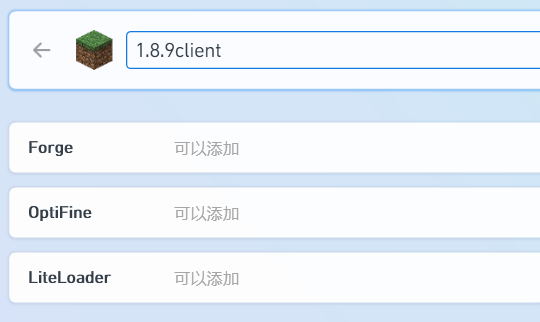

# Amethyst Client (Rebuilt)

> 基于 `Amethyst-Client-1.0.1.jar` 反编译重建的 Minecraft 1.8.9 Legacy Fabric PvP 客户端源码仓库  
> 原版闭源协议声明 `All-Rights-Reserved` 本仓库仅用于代码审计 架构研究与技术整活

## 项目简介

Amethyst Client 1.0.1 是一个面向 Minecraft 1.8.9（Legacy Fabric）的 PvP 增强客户端 打包体量高达 **13.65 MB**（192 个 Java 源文件 约 30392 行代码 外加 15.94 MB 未压缩资源） 内置了以下四大模块入口：

- `net.client.Client`：主客户端功能（右 Shift 打开 Material Design 3 风格设置面板 包含 1.7 格挡挥刀 受击残影 自由视角 动态模糊 自动疾跑 自定义准星 计时/天气/雾效/附魔光效覆写 账号管理 模组更新检查以及基于 JNA/IMM32 的 Windows 中文输入法修复）
- `net.client.replay.ReplayClient`：内置回放录屏与离线渲染子系统（支持数据包与实体快照录制 路径相机编辑器 FFmpeg 导出 手写 MJPEG AVI 导出与 PNG 序列导出）
- `com.mcpacks.McPacksMod`：内置资源包管理器（移植自上游 FastPacks / McPacks）
- `com.amethyst.blur.Blur`：界面背景模糊（移植自上游 tterrag1098/Blur）

## 环境要求与构建

- **Minecraft**：`1.8.9`
- **加载器**：Legacy Fabric Loader `>= 0.12.0`（源码推荐 `0.20.1`）
- **JDK**：**Java 21 及以上**（`fabric.mod.json` 与 `EnvCheck` 强推 **Java 25 LTS**）
- **构建产物**：运行构建脚本后会在 `dist/` 目录导出 `Amethyst-Client-1.0.1-rebuilt.jar`

```powershell
# Windows
.\gradlew.bat assemble

# 如需代理拉取 1.8.9 依赖（gradle/minecraft.gradle 默认尝试直连与 http://127.0.0.1:7890）
$env:AMETHYST_PROXY="http://127.0.0.1:7890"
.\gradlew.bat build
```

如需校验重建产物与原始 jar 的非 synthetic 类/字段/方法签名一致性 可直接运行根目录下的 `CompareClasses.java`

## 目录结构

```text
Amethyst-Client-rebuilt/
├── build.gradle                    # 构建配置（options.release = 21）
├── gradle/minecraft.gradle         # 自动拉取 1.8.9 原版客户端与 Legacy Fabric 映射并重映射
├── CompareClasses.java             # ASM 类签名零差异对比工具
└── src/main/
    ├── java/
    │   ├── net/client/             # 客户端主逻辑 MD3 界面 账号 输入法 Replay 子系统
    │   ├── com/mcpacks/            # 缝合进来的 FastPacks 资源包管理器
    │   └── com/amethyst/blur/      # 缝合进来的 Blur 背景模糊
    └── resources/
        ├── fabric.mod.json         # modid 甚至直接叫 "client"
        ├── assets/md3/font/        # 15 套预烘焙静态位图字库（15.3 MB 体重核心来源）
        ├── META-INF/jars/          # 内嵌 550 KB 的 jna-win-5.17.0.jar
        ├── LICENSE                 # 五千字闭源铁律
        └── THIRD_PARTY.md          # 包含幽灵类声明的第三方清单
```

---

## 评价 Amethyst Client 1.0.1 最爱闭源 最爱塞图集的 1.8.9 客户端

前面正经的读我写完了 接下来进入正题

Amethyst Client 是一个面向 2015 年老古董 **Minecraft 1.8.9** 制作的 [Legacy Fabric](https://legacyfabric.net/) PvP 客户端  看起来非常现代 可惜作者的大脑疑似遭到了碾压居然在1.8.9制作fabirc模组非常有 Material Design 3 审美 甚至在 `LICENSE` 里写了一篇堪比联合国宪章的 `All-Rights-Reserved` 声明严禁反编译严禁逆向严禁提取任何资源 仿佛里面藏着什么价值连城的核聚变源代码 但是笔者把这个 **13.65 MB** 的肥美 jar 扔进反编译器之后 发现里面的精彩程度已经远远超出了 PvP 客户端的范畴 可惜作者的大脑疑似遭到了碾压居然在1.8.9制作fabirc模组 本文将带你逐行观赏它到底是个什么东西

### 一 把防盗门焊死在草坪正中央的闭源哲学

首先最令人[蒙古](https://zh.wikipedia.org/zh-hans/%E8%92%99%E5%8F%A4%E5%9B%BD)的不是它闭源 而是它闭源的方式

打开 `src/main/resources/LICENSE` 作者用极其严肃的法律英文郑重宣告 `It is NOT open source` 严禁反编译 严禁反汇编 严禁逆向工程 严禁提取字体与图标图集 违者许可自动终止 看起来杀气腾腾仿佛下一秒就要寄律师函 结果你把 `Amethyst-Client-1.0.1.jar` 打开一看 **连一行混淆都没有** 类名 方法名 常量名 外加全套中文报错日志清清爽爽地躺在那里裸奔 连根目录自带的 `CompareClasses.java` 都是用来校验反编译重建产物与原包非 synthetic 签名 **0 差异** 的 这就好比你在大草原正中央焊了一扇 C 级锁芯防爆防盗门 门上贴满“闲人免进 违者必究”的红底白字告示 然后四周连围墙都没砌

更乐的是打开 `THIRD_PARTY.md` 作者在“三 说明”里信誓旦旦地写着：

> 唯一例外是 `net.client.util.BackdropBlurPipeline` 的背景模糊着色器与 pass 流程移植自 Blur

笔者翻遍了整个仓库 192 个 Java 文件 30392 行代码 结果 `BackdropBlurPipeline` 命中次数为 **0** 压根不存在这么一个类 真正干活的是直接作为独立 entrypoint 缝在 `fabric.mod.json` 里的 `com.amethyst.blur.Blur` 顺便一提 作者在 `fabric.mod.json` 里一口气缝了四个客户端入口（`Client` `McPacksMod` `ReplayClient` `Blur`） 却给整个模组起了一个史诗级 modid 叫 **`"client"`** 仿佛全宇宙的 1.8.9 模组生态里只有他一家配叫 client 生怕不和别人的模组撞 ID

### 二 1.8.9 强制 Java 21+ 配小众 Legacy Fabric 以及永远执行不到的温馨提示

众所周知 2015 年的 Minecraft 1.8.9 整个正统生态基本都是 **Forge + Java 8** 走天下 无论是各种老牌 1.8.9 PvP 模组还是主流启动器的默认配置 全是照着 Java 8 来的 而且 **[Fabric 官方](https://fabricmc.net/)从诞生起就是面向 1.14 及以上版本 压根就不支持 1.8.9**

结果 Amethyst Client 偏偏要走一条反直觉的逆行大道：抛弃生态最肥美的 1.8.9 Forge 转头绑死在极冷门的第三方分支 **Legacy Fabric** 上 更令普通玩家两眼一黑的是 打开国内最常用的 **PCL2 启动器** 准备建一个 1.8.9 实例时 你会发现安装列表里只有 `Forge` `OptiFine` `LiteLoader` **压根就没有 1.8.9 Fabric / Legacy Fabric 的安装入口**



> 请注意这已经是 PCL2 给 1.8.9 提供的全部加载器选项了 想装这个客户端还得自己到处找 Legacy Fabric 安装器或者手搓实例 json

你以为折腾完小众加载器就能愉快进游戏了吗 格局小了 1.8.9 玩家好不容易配好 Java 8 刚点启动直接炸脸 因为 Amethyst Client 直接把整个项目的编译目标锁死在了 **Java 21**（原版 `Amethyst-Client-1.0.1.jar` 里全部 **278 个 `.class` 文件**字节码主版本号清一色是 **65**） `fabric.mod.json` 写明 `"java": ">=21"` 简介和 `EnvCheck.java` 里甚至反复按头安利 **Java 25 LTS**

硬要让十一年前本该用 Java 8 启动的老版本在 Java 25 上起飞也就算了 毕竟尊重个人爱好 最让笔者绷不住的是 `net.client.util.EnvCheck` 里写了整整 **406 行** 去检测玩家的 Java 版本 甚至极其贴心地写了这么一个分支：

```java
if (major < 21) {
    javaStatus = new EnvCheck.Status(
        "Java " + localTag + vendorTagZh + " · 无法运行（本模组需要 Java 21 及以上（推荐 25 LTS））", ...
    );
}
```

哥们 你字节码本身都是按 **Java 21（class version 65）** 编译的啊 如果 1.8.9 玩家按常识用了 Java 8 启动 JVM 在加载你这个 `EnvCheck.class` 之前就已经一巴掌拍出一个 `UnsupportedClassVersionError` 直接原地螺旋升天了 你这行苦口婆心的中文提示大概只有在平行宇宙或者下五个[地质年代](https://zh.wikipedia.org/zh-hans/%E5%9C%B0%E8%B4%A8%E5%B9%B4%E4%BB%A3)里才有机会被执行一次

### 三 13.65 MB 客户端里塞了 15 MB 静态字库 还没打架先把显卡喂饱

当你看到一个 1.8.9 PvP 客户端体积高达 **13.65 MB** 的时候 你可能会以为它内置了光追引擎 或者塞了一整套客户端反作弊内核 结果解包 `assets/md3/font/` 一看 差点给笔者看傻了：

**整整 15 套预烘焙静态位图字库**

作者把 `regular_9` `medium_10` `regular_11` `regular_12` `medium_12` `medium_13` `regular_14` `medium_15` `regular_18` `medium_18` `regular_21` `regular_24` `regular_25` `regular_29` `regular_34` 每一个字号都单独栅格化成了一张巨型 PNG 和一个几百 KB 的 JSON（其中 `regular_14.png` `regular_12.png` `medium_12.png` 三张直接干到 **4096×4096** 还有五张 **2048×2048** 六张 **1024×1024**） 光这 15 对 PNG+JSON 未压缩就占了 **15.3 MB** 也就是说你下载这个客户端有超过 90% 的流量都在下载字号相差 1 像素的 Roboto 与思源黑体图片

你以为磁盘大就完了吗 格局小了 请看 `net.client.ui.md3.render.Md3Gl.uploadText()` 的神级操作：

1. 先用 `ImageIO.read` 在主线程把几兆的 PNG 读成 `BufferedImage`
2. 判断出它是灰度图之后 **在 CPU 上用循环把每个灰度字节硬生生展开成 4 字节 `(255 255 255 gray)`**
3. 最后用 `GL11.glTexImage2D(..., GL_RGBA, ...)` 一股脑塞进显卡显存

笔者没消耗任何 [token](https://zh.wikipedia.org/zh-hans/%E4%BB%A3%E5%B8%81) 拿[大脑](https://zh.wikipedia.org/zh-hans/%E5%A4%A7%E8%84%91)稍微算了一下：这 15 张图集如果全部加载进显存 光是用来渲染你这个 Material Design 3 菜单的字形纹理 就要实打实吃掉 **309.0 MB 未压缩 RGBA 显存** 隔壁 1.8.9 玩家还在为了多挤出 20 帧把视距调到 6 区块 你这边还没进床战大厅 光打开设置面板先把显卡给撑得打嗝了 不会写 SDF/MSDF 哪怕用单通道 `GL_ALPHA` 也能省 75% 显存啊 怎么就非要四倍体积拉满呢

### 四 赛博阑尾 3277 行巨石与 854 行纯手工 JPEG 编码器

接着往下翻源码 笔者的[大语言模型](https://zh-classical.wikipedia.org/wiki/%E5%A4%A7%E8%AA%9E%E8%A8%80%E6%A8%A1%E5%9E%8B)雷达直接报警响个不停 随手就能捞出好几件镇馆之宝：

- **1.8.9 里强行探测 NanoVG 的赛博阑尾**：`Client.java` 启动时专门跑了一个 `probeNanoVg()` 方法 兴冲冲地去 `Class.forName("org.lwjgl.nanovg.NanoVG")` 和 `NanoVGGL2` 然后抓个异常打一条 `NanoVGGL2 类探测失败` 的警告日志 问题是 1.8.9 用的是 **LWJGL 2** 压根没有 NanoVG 而且全项目 30392 行代码里除了 `Client.java` 这 4 行之外 **再也没有任何地方调用过 NanoVG** 明显是早期让溜溜梅画饼打算上 NanoVG 后来发现 LWJGL 2 跑不通改去烘焙 309 MB 位图字库了 但把这段探测代码忘在启动流程里 每次开机都要对着空气赛博通灵一次
- **3277 行单体巨石 `ClientScreen.java`**：一个设置界面写了 **3277 行 114 个方法** 搭配 `SettingsSpec.java` 里满屏幕不连续的魔法数字常量（`FOV_ON = 6` `THEME_COLOR = 103` `GLASS_MODE = 110` `HEART_BLINK = 111` `G_SWING = 200`）和巨型 `int[][] ROWS` 二维数组 读起来仿佛在考古 1983 年的银行大型机 COBOL 账本
- **854 行纯 Java 手搓 `JpegEncoder.java`**：作者为了给内置回放模块里的 `MjpegAviWriter` 编码 MJPEG 视频 居然在 `net.client.replay.render.JpegEncoder` 里硬生生手写了 **854 行** 完整 Baseline JPEG 编码器（ZigZag 表 亮度/色度量化表 离散余弦变换 霍夫曼编码一应俱全） 然而就在同一个项目的 `Md3Gl.java` 和 `AsyncIconLoader.java` 里 JVM 标准库自带的 `javax.imageio.ImageIO` 早就 import 进来了 更抽象的是旁边还同时躺着 `FfmpegWriter` 和 `PngSequenceWriter` 一个 1.8.9 PvP 客户端硬是给自己造了三套视频导出管线加一套纯 Java 编解码轮子 只能说 [Claude Max](https://claude.ai/) 订阅额度不烧完确实睡不着觉
- **自带 Gson 却偏要用正则硬切 JSON 的更新检查三件套**：Minecraft 1.8.9 原版依赖里就带着 `com.google.gson` 项目里 `Auth.java` 和 `Accounts.java` 也用得飞起 结果到了 `EnvCheck` `CurseForgeUpdater` 和 `ModrinthUpdater` 作者突然返璞归真 全部改用 `Pattern.compile` 正则硬抠 JSON 尤其是 `CurseForgeUpdater.pick189File()` 在正则命中 `"1.8.9"` 之后 直接 `Math.max(0, m.start() - 900)` **往回硬截 900 个字符** 再拿正则去捞 `"display"` 属于是把结构化 JSON 当成摩斯电码在手撕
- **让人眼前一黑的布尔逻辑**：打开 `ModrinthUpdater.java` 第 41 行 赫然写着一行足以载入史册的条件判断：

```java
if (!started && modIds != null && !modIds.isEmpty() || !started) {
```

这行表达式在布尔代数里等价于 `if (!started)` 前面辛辛苦苦写的 `modIds != null && !modIds.isEmpty()` 被后面的 `|| !started` 一脚踹进了下水道 一旦传进来个 `null` 直接进分支在下一行 `new ArrayList<>(modIds)` 光速空指针 顺便它连 `isSelf()` 都比隔壁 `CurseForgeUpdater` 少写了个 `"fabricloader"` 每次检查更新还要顺手去问候一下 Modrinth 官网有没有一个叫 `fabricloader` 的 1.8.9 模组

### 五 微软正版登录请自带 Azure 应用 以及裸奔的 Token 与反射

再来看看客户端自带的账号管理系统 同样充满了行为艺术：

1. **自带微软正版登录 但不带 Client ID**：`ClientConfig.msClientId` 默认是空字符串 `""` 想在客户端里用微软设备码登录正版账号？请玩家先自行注册 Microsoft Azure 开发者账号 创建应用注册 拿到 Client ID 再手动填进客户端文本框里 什么叫极致的 DIY 精神 建议下次直接让玩家自己写 OAuth2 握手报文
2. **AccessToken 明文落盘**：`Accounts.save()` 直接用 `GSON.toJson` 把正版与皮肤站的 `token` 明文写进 `config/client-accounts.json` 没有任何加密保护 一打开就能复制粘贴
3. **兜了个寂寞的反射回退**：`Accounts.apply()` 在 `SessionAccessor` 写入失败时会走反射兜底 代码写的是 `class_1600.class.getDeclaredField("session")`——朋友 你都把 `MinecraftClient` 编译成 Legacy Fabric intermediary 名字 `class_1600` 了 运行时哪来的明文 `"session"` 字段啊 一旦真的触发兜底必然原地 `NoSuchFieldException`

至于 `MotionBlurMixin.java` 里写了 475 行全套 OpenGL 1.1 `GL_QUADS` 固定管线拷屏叠图 外加清一色 `lc$tex` `lc$drawTemporal` `lc$copyScreenToTexture` 的神秘 `lc$` 前缀（以及为了修 Windows 输入法硬塞进 jar-in-jar 的 550 KB `jna-win-5.17.0.jar`） 笔者看累了 只能表示尊重

---

当然笔者[喷](https://zh.wikipedia.org/zh-hans/%E5%96%B7%E5%AD%90)了这么多肯定会有人说我是杠精 接下来笔者给原作者提供几个不消耗任何 token 纯靠人类大脑想出来的[解决方案](https://learn.microsoft.com/zh-cn/visualstudio/ide/solutions-and-projects-in-visual-studio)：

1. 字体渲染换成单张 SDF/MSDF 图集或者按需动态光栅化 哪怕懒得改算法至少把 `Md3Gl.uploadText()` 改成单通道纹理 别拿 15 张静态图集和 309 MB 显存折磨 1.8.9 玩家的显卡
2. 把 `ClientScreen.java` 那 3277 行拆一拆 把 `SettingsSpec` 的魔法数字换成正经枚举 顺便把永远不会跑到的 `if (major < 21)` 和只负责抛异常的 `probeNanoVg()` 删了
3. 别再拿正则和 `m.start() - 900` 暴力切片解析 JSON 了 Gson 就在你的 classpath 里躺着呢 还有把 `ModrinthUpdater` 那行 `|| !started` 和 `Accounts` 的 `"session"` 反射修修
4. 既然都写了五千字 `All-Rights-Reserved` 禁止反编译 至少给 jar 加个混淆或者别把 `THIRD_PARTY.md` 里不存在的幽灵类写进文档里
5. 给你的雷霆UI换成nanovg渲染 
什么？你这个要求 Java 25 推荐环境 塞了 309 MB 字体显存和 854 行手写 JPEG 编码器的 1.8.9 闭源 PvP 客户端 连一行混淆都没加就直接发 Release 了。？那没事了。！

你就继续搞字库吧 15 张静态图集一点都不重 3277 行单文件一点都不累 闭源协议猛贴 大 token 猛烧 给 Minecraft 1.8.9 生态继续输送更多雷霆大肥美杰作
